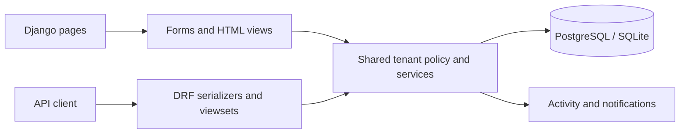

# TaskFlow

**A Django team workspace with a responsive interface, REST API, and organization-scoped collaboration.**

[](https://github.com/mohammadrezaxp/TaskFlow/actions/workflows/ci.yml)

[Architecture](#architecture) · [Access policy](#access-policy) · [API](#api) · [Validation](#validation) · [Deployment](#deployment)

Create an organization, invite teammates, plan projects, assign tasks, move work through Kanban, discuss decisions, and inspect progress. The browser and API check organization membership on resource access and writes.

## Features

| Area | Implemented behavior |
| --- | --- |
| Accounts | Registration, session/JWT authentication, profiles, image avatars, password change/reset |
| Organizations | Owner membership on creation, role management, member removal, and private team views |
| Invitations | Hashed random tokens, seven-day expiry, email-bound acceptance, revocation, and single use |
| Projects | Create, view, edit and delete; validate dates and organization access |
| Tasks | CRUD, priorities, assignment validation, due dates, search, status filters, personal task lists |
| Kanban | Persistent drag-and-drop status/order changes; task editing offers a keyboard-accessible alternative |
| Collaboration | Task comments, organization message channels, assignment/comment notifications, read actions and preferences |
| Reporting | Dashboard, due-date calendar, status distribution, project completion, and activity history |
| Operations | Development fixtures, OpenAPI/Swagger/ReDoc, Django admin, Docker Compose, and GitHub Actions |

Business data lives in the database. Only the theme uses browser storage. Messages and notifications refresh on page load; this version does not use WebSockets.

The UI adapts the supplied **TaskFlow Complete UI Kit**. The standalone mock SPA script is not loaded by Django pages. Forms, views, database queries, permissions, and CSRF checks drive the application.

## Quick start

Python 3.12 · Django 5.2 · DRF · SimpleJWT · PostgreSQL/SQLite · WhiteNoise · Gunicorn · pytest

```bash
git clone https://github.com/mohammadrezaxp/TaskFlow.git
cd TaskFlow
python -m venv .venv
```

Activate with `source .venv/bin/activate` on Linux/macOS or `.venv\Scripts\Activate.ps1` in PowerShell. Install dependencies, copy `.env.example` to `.env`, and generate your own `SECRET_KEY`:

```bash
python -m pip install -r requirements.txt
python -c "from django.core.management.utils import get_random_secret_key; print(get_random_secret_key())"
python manage.py migrate
python manage.py runserver
```

Open [TaskFlow locally](http://127.0.0.1:8000/). Register, create an organization, then add a project and tasks. `manage.py` selects development settings unless `DJANGO_SETTINGS_MODULE` is supplied explicitly.

### Portfolio demo

```bash
python manage.py seed_demo --password 'Choose-a-local-demo-password!'
```

This development-only command creates fictional `demo` and `sam` accounts, one organization, three projects, 18 tasks, notifications, and messages. Use the password you supplied to sign in. Re-running does not reset existing passwords or duplicate fixture tasks. The command refuses to run when `DEBUG=False`; never seed a public production database with demo accounts.

## Architecture



```text
apps/accounts/       Account forms, authentication, profiles, and avatars
apps/organizations/ Organization, membership, and invitation models
apps/projects/      Project model and compatibility exports
apps/tasks/         Task/comment models and migrations
apps/core/          Shared policy, services, HTML/API views, and demo command
apps/notifications/ Notifications, preferences, and organization messages
apps/activity/      Organization activity records
config/settings/    Base, development, and production settings
templates/          Server-rendered interface adapted from the supplied UI kit
static/taskflow/    Styles, theme switching, and CSRF-aware Kanban behavior
tests/              Account, security, UI, and domain regression tests
```

Requests and multi-step domain operations use database transactions. Kanban moves lock their project/task records and recalculate destination ordering. PostgreSQL is the deployment database; SQLite is the local default.

## Access policy

| Action | Owner | Admin | Manager | Member |
| --- | :---: | :---: | :---: | :---: |
| View own organization's work and channels | ✓ | ✓ | ✓ | ✓ |
| Create/edit tasks and post comments/messages | ✓ | ✓ | ✓ | ✓ |
| Create/edit/delete projects | ✓ | ✓ | ✓ | — |
| Edit organization through API | ✓ | ✓ | — | — |
| Invite/manage ordinary members and managers | ✓ | ✓ | — | — |
| Invite/manage administrators | ✓ | — | — | — |
| Delete organization | ✓ | — | — | — |

Members cannot remove/demote the owner, change their own role through membership management, move resources across tenants, or assign work outside the organization. Member removal clears their task assignments. Comment changes require the author or an organization owner/admin.

Invitations are links for private sharing; **no invitation email is sent automatically**. Password-reset delivery uses Django's email backend; development prints messages to the console.

## API

Swagger: `/api/docs/` · ReDoc: `/api/redoc/` · OpenAPI: `/api/schema/`

| Route | Purpose |
| --- | --- |
| `/accounts/api/register/` | POST registration with `password` and `password_confirm` |
| `/accounts/api/token/`, `/accounts/api/token/refresh/` | JWT issue/refresh |
| `/accounts/api/me/` | GET/PATCH current profile |
| `/accounts/api/profile/{username}/` | Intentionally public profile fields |
| `/api/v1/organizations/` | Organization list/create and detail CRUD |
| `/api/v1/projects/` | Project list/create and detail CRUD |
| `/api/v1/tasks/` | Task list/create and detail CRUD |
| `/api/v1/tasks/{id}/reorder/` | PATCH position and optional status |
| `/api/v1/task-comments/` | Task comment list/create and detail CRUD |
| `/health/` | Application and database readiness |

JWT bearer and session authentication are enabled. Session-authenticated writes require CSRF; bearer clients use `Authorization: Bearer ...`. Resource IDs are UUIDs. Browser lists are paginated; API collections are currently unpaginated.

```bash
curl -X POST http://127.0.0.1:8000/accounts/api/token/ \
  -H 'Content-Type: application/json' \
  -d '{"username":"your-user","password":"your-password"}'

curl http://127.0.0.1:8000/api/v1/tasks/ \
  -H 'Authorization: Bearer YOUR_ACCESS_TOKEN'
```

## Validation

```bash
python manage.py check
python manage.py makemigrations --check --dry-run
pytest -q
python manage.py spectacular --file schema.yml --validate --fail-on-warn
```

Tests cover account/browser flows, cross-tenant read/create/update rejection, roles, comments, assignments, Kanban ordering, invitation expiry/reuse, owner protection, member removal, notification ownership, escaped messages, CSRF, password reset, and rollback. CI runs PostgreSQL tests, validates OpenAPI, and builds Docker. Inspect the [workflow history](https://github.com/mohammadrezaxp/TaskFlow/actions) for current results.

## Deployment

For **local HTTP Docker Compose**, set a unique `SECRET_KEY` and URL-safe `POSTGRES_PASSWORD` in `.env`:

```bash
docker compose up --build -d db
docker compose run --rm web python manage.py migrate
docker compose run --rm web python manage.py createsuperuser
docker compose up -d web
```

Compose disables secure-cookie/SSL redirects for localhost port 8000. Public deployment requires HTTPS, explicit allowed hosts, a trusted proxy, secure cookies/redirects, and database/media backup procedures. Keep `.env`, database files, and uploads out of Git.

Without Compose, set `DJANGO_SETTINGS_MODULE=config.settings.production`, `SECRET_KEY`, `DATABASE_URL`, and `ALLOWED_HOSTS`; run migrations and `collectstatic`; then start `gunicorn config.wsgi:application --bind 0.0.0.0:8000` behind your HTTPS proxy. Configure email delivery if users need password-reset mail beyond console output.

WhiteNoise serves compressed/versioned static assets. Avatar uploads are limited to 5 MB and re-encoded as PNG when served; no directory-wide media route is exposed.

## Boundaries

- Channels use refresh-based messaging, not direct messaging or live presence.
- Reports describe current task state, not historical burndown.
- Activity records are an application audit trail, not a tamper-proof compliance ledger.
- Default DRF throttling uses a process-local cache; distributed abuse prevention needs deployment-specific configuration.
- Email verification, SSO, billing, recurring tasks, attachments, and WebSockets are not implemented.
- Passing tests do not replace a production security review or concurrency/load testing.

## Contributing and license

Keep tenant policy consistent across browser and API paths and include regression tests with access-control changes. Report security concerns to [the maintainer](mailto:m.mahmoudi.xp@gmail.com). Licensed under [MIT](LICENSE).
